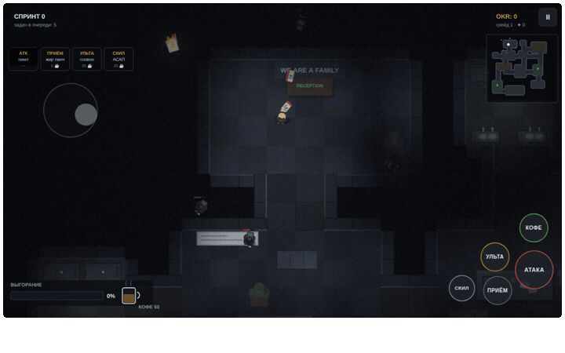
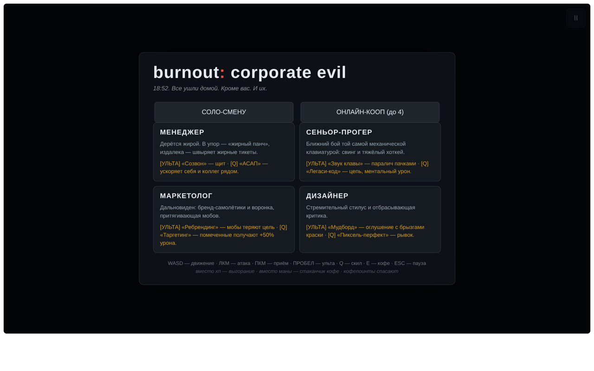
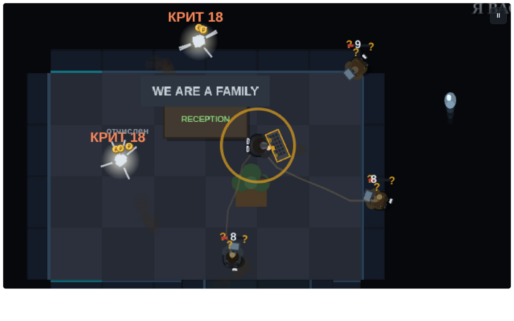
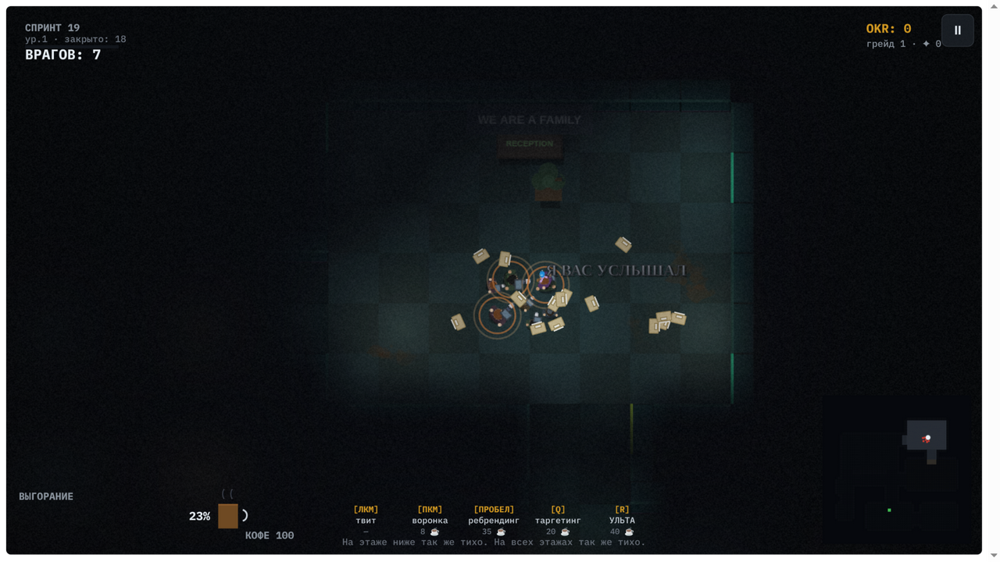
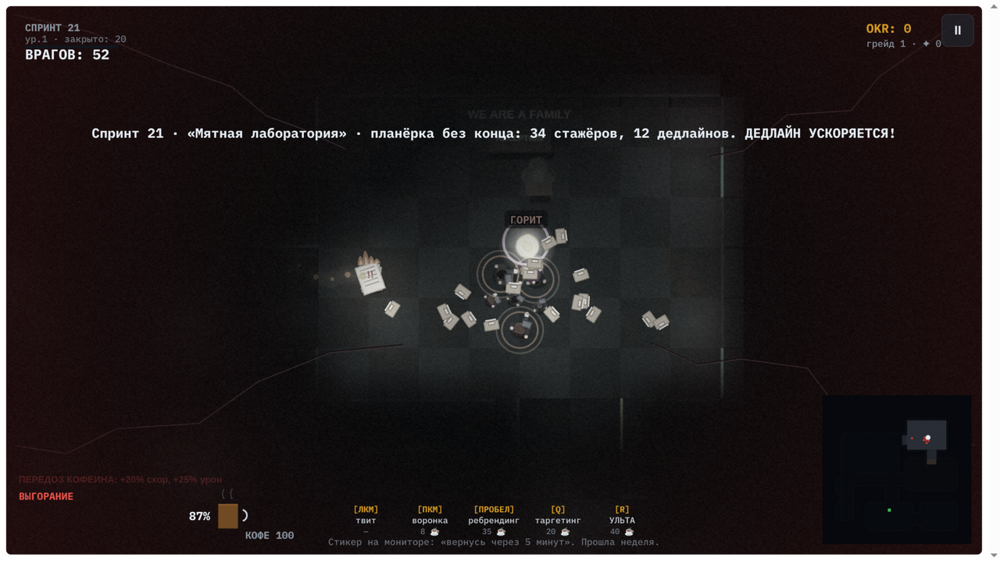
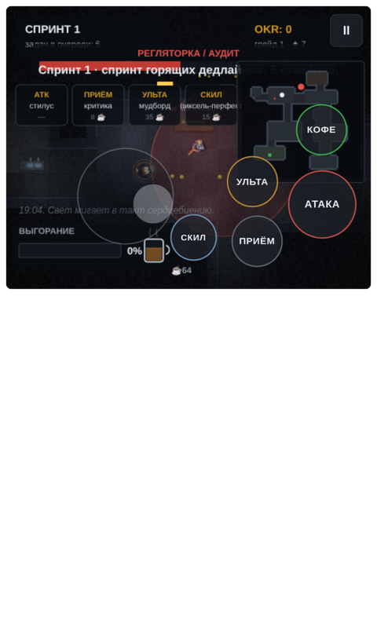

# brnout: corporate hell 🔥💼

> **Диабло-слэшер в опенспейсе после заката.** HR уже ушёл домой. Дедлайны — нет.
> *A Diablo-like office slasher. It's 18:52. Everyone went home. Except the deadlines.*



**[▶ Играть прямо сейчас](#запуск)** · без сборки, без аккаунтов, один HTML + браузер

---

## Что это

Каждый спринт — волна стажёров и горящих дедлайнов. Вместо здоровья — **индикатор выгорания**,
вместо маны — **стаканчик кофе**. Кофепоинты — ваши святилища. Каждые 5 спринтов приходит
**АУДИТ**. Ваша цель — закрыть OKR и не сгореть (или сгореть красиво — за это тоже дают очки).



## Классы

| Класс | Стиль | Приёмы (ЛКМ · ПКМ · ПРОБЕЛ · Q) |
|---|---|---|
| **Менеджер** 🕴️ | дальний бой «жирой» | JIRA-тикеты · жирный панч · **«У меня созвон»** (щит) · **АСАП** (ускоряет команду) |
| **Программист** 🧢 | ближний бой, контроль | та самая механическая клава · хоткей · **«Звук клавы»** (паралич пачками) · **Легаси-код** (цепь + ментальный урон) |
| **Маркетолог** 📣 | дальний, дебаффы | твиты · телеграм · инстаграм (звук — как уведомления) · воронка (притягивает) · **Ребрендинг** · **Таргетинг** |
| **Дизайнер** 👓 | мобильный мили | стремительный стилус · критика (отбрасывает) · **Мудборд** (стан с краской) · **Пиксель-перфект** (рывок) |

## Абсолютные ульты — клавиша **R** (открываются на 9-м спринте)

| Класс | Ульта | Что происходит |
|---|---|---|
| Прогер | **ВЫГОРАНИЕ** | падает на пол, корпусной ключ вырывает 26 клавиш — они разлетаются снарядами и молотят врагов |
| Менеджер | **ПЛАНИРОВКА** | 8 секунд вся команда: +50% урона, +15% скорости, золотые ауры |
| Дизайнер | **КОМИК САНС** | призывает демона шрифта: 10 секунд летает рядом и расстреливает мобов «POW»-метриками |
| Маркетолог | **3 СЕНТЯБРЯ** | рекламная кампания со звездой: зона горящей рябины жжёт всех внутри, экран залито «3 сентября» |



## Кампания и прокачка

**10 спринтов, аудит на 5-м и финальный на 10-м.** Победа — только после финального аудита.

- **Уровни**: за убийства капает опыт → уровень → **+10% урона** за уровень.
- **Сложность растёт следом**: HP мобов и боссов скейлится от уровня, счёт мобов растёт всю игру (до 34+12 за волну).
- **Супер-мобы** (элита) трёх характеров: «стажёр года» (танк), «на энергетиках» (быстрый), «обиженный» (бьёт в 1.7× больнее).
- **Выгорание 25→100%** — экран постепенно теряет цвет, покрывается трещинами, зрение сужается в тоннель. Адреналин на 80+ всё ещё даёт +20% скорости и +25% урона — гори красиво.

## Мясо геймплея

- **Комбо ×2…×9** — серия убийств без урона: «синергия! … выгорел красиво! … БОГ ВЫГОРАНИЯ!». Сброс при попадании.
- **Криты 15%** — по боссу вместо цифр фонтаном летят монеты, а «ПРАВКА!», «ДЕДЛАЙН!», «УВОЛЕН!» уходят в небо.
- **Диабло-смерти** — стон, улетающая душа с выдохом «аааах», горсть монет из каждого трупа.
- **Адреналин** — при выгорании >80: «ПЕРЕДОЗ КОФЕИНА», +20% скорости, +25% урона. Работает, только пока горишь.
- **Пауза между спринтами не блокирует**: сверху компактная панель итогов и кнопка «▶ Запустить следующий спринт [ENTER]», авто-старт через 20 секунд — всё это время можно бегать и собирать лут.
- **Рывок-уворот на ПРОБЕЛ** — короткий дэш с i-frames: проходит сквозь пули, дедлайны и «Я ВАС УСЛЫШАЛ».
- **Уютные офисы** — лаунж-зоны с ковром, диваном и торшером, тёплые лампы, постеры-«закаты», растения и коробки переездов: биофильный дизайн и зонирование вместо бездушных коридоров.
- **Разрушаемость** — столы ломаются пополам, мониторы взрываются искрами, кулеры заливают ковролин (вода замедляет мобов), принтеры устраивают метель из А4.
- **Пассивно-агрессивные атаки** — «Я ВАС УСЛЫШАЛ» материализуется каменными буквами и прилетает в героя.
- **Монеты** — магнитятся, собираются, идут в финальный счёт и **лидерборд коопа**.

 
 

## Кооп до 4 игроков, без сервера

P2P поверх WebRTC (PeerJS). Своего игрового сервера не нужно — только бесплатный сигнальный брокер.

1. Хост: **ОНЛАЙН-КООП → Создать комнату** → код из 5 букв
2. Друзья: **Войти по коду** — можно даже посреди боя
3. Хост жмёт «Начать спринт» — у всех одна и та же процедурная карта

Хост-авторитарная синхронизация: ввод 30 Гц, снапшоты 15 Гц, предикт своего движения.

## Карта

Квадратный процедурный «данж» — опенспейс, переговорки, кладовки, уборные и ресепшн,
соединённые коридорами. Мобы приходят **с ресепшена, из уборных и от кофепоинтов**.
Каждый забег — новый офис. Гарантированная связность (флуд-филл + починка коридоров),
мебель без наложений — всё проверяется тестами на сотнях сидов.

## Музыка и атмосфера

Генеративный **тёмный синтвейв** (WebAudio, 100 BPM): пульсирующий бас, арпеджио с дилэем,
сочинённая 8-тактовая тема с вибрато, драм-секция с филлами, дрон-педаль — интенсивность
растёт вместе с замесом. Плюс: четверть ламп мертвы, виньетка, зерно и редкие шёпты
в опенспейсе.

## Управление

| Платформа | |
|---|---|
| **ПК** | WASD — движение · мышь — прицел · ЛКМ — выстрел (без автоатаки) · ПКМ — приём · **ПРОБЕЛ — рывок-уворот** (i-frames, КД 2.6с) · **F — ульта класса** · **Q — скил** · **R — абсолютная ульта** · E — кофе · ESC — пауза |
| **Тач** | джойстик появляется в точке касания · автонацеливание · кнопки АТАКА/ПРИЁМ/УЛЬТА/СКИЛ |



## Запуск

Никакой сборки. Любой статический сервер:

```bash
git clone <этот-репозиторий>
cd burnout-corporate-evil
python3 -m http.server 8080
# откройте http://localhost:8080
```

Свои устройства в одной сети: `http://<ваш-ip>:8080` — и кооп между телефоном и ПК.

**Свой сигнальный брокер** (опционально): `npx peer --port 9000 --path /peerserver`,
затем откройте игру с `?broker=<ip>:9000`. По умолчанию — бесплатный PeerJS Cloud.

## Тесты

```bash
node tests/run.js   # 19 тестов: связность карты (300 сидов), детерминизм, мебель без наложений, данные классов/музыки
```

## Структура

```
src/          16 ES5-модулей (без сборки): map, combat, abilities, chaos, sim, guest, net, sprites, render, music…
tests/        node-раннер со стабами DOM
docs/         скриншоты и демо
index.html    точка входа
```

## Создано с ИИ

**AI-Generated with GLM-5.3** — вся игра (движок, спрайты, музыка, сетевой код, тесты)
написана в ZCode агентной сессии вместе с человеком, который нёс фидбек и вкус.

Хочешь так же?

> 🚀 **You've been invited to join the GLM Coding Plan!**
> Enjoy full support for Claude Code, Cline, and 20+ top coding tools — starting at just $18/month.
> Subscribe now and grab the limited-time deal!
> 👉 **Join now: <https://z.ai/subscribe?ic=TO74CDBVLT>**

## License

MIT — забирайте в прод (шутка. или нет)
